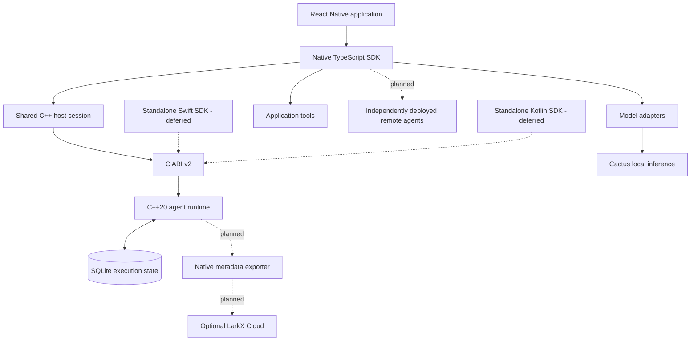

# LarkX

[](https://github.com/larkxai/larkx/actions/workflows/ci.yml)
[](https://github.com/larkxai/larkx/actions/workflows/release.yml)
[](https://www.npmjs.com/package/@larkxai/core)
[](https://www.npmjs.com/package/@larkxai/react-native)
[](./LICENSE)

**Durable orchestration for on-device AI agents.**

AI agents need more than inference. They make decisions, call tools, update application state and depend on services. On mobile devices, applications can be suspended or killed at any point. A lost connection or interrupted process should not mean starting the entire agent again.

LarkX is an open-source, local-first execution runtime that persists agent progress on the device and recovers from interruptions. Its direction is hybrid orchestration: local agents collaborating with cloud models and independently deployed remote agents, without requiring a cloud coordinator to own the local run.

**Inference engines run models. LarkX runs agents.**

[Website](https://larkx.ai) · [Roadmap](ROADMAP.md) · [React Native SDK](packages/react-native/README.md) · [Native architecture](docs/native/migration.md)

## What you can build today

- Durable local agents with model-driven tool selection.
- React Native agents backed by the shared C++20 runtime and SQLite.
- Local model integration through the optional Cactus adapter.
- Replay of committed decisions and tool results, with explicit recovery policies for interrupted operations.
- Existing TypeScript workflows and agents on Node.js and React Native.
- Optional metadata-only telemetry for the existing TypeScript engine.

**Developer preview:** the native core and React Native host are implemented and tested on host platforms. Native bridge compilation is covered by CI. Full mobile application builds, real Cactus inference, offline operation and killed-process recovery on physical phones remain unverified. Remote delegation, A2A, expanded privacy policies and native telemetry are planned, not available yet.

## React Native native runtime

Import this from `@larkxai/react-native/native`. It does not replace the default package export.

```typescript
import { createRuntime, defineTool, scriptedModel, sqlite } from "@larkxai/react-native/native";

const runtime = await createRuntime({ storage: sqlite() });
const agent = runtime.createAgent({
  name: "personal-assistant",
  version: 1,
  model: scriptedModel([
    {
      message: null,
      finish: "tool_calls",
      calls: [{ id: "call-1", name: "read_notes", arguments: {} }],
    },
    { message: "Summary: Example note", finish: "stop", calls: [] },
  ]),
  instructions: "Help the user manage daily tasks.",
  tools: [
    defineTool({
      name: "read_notes",
      description: "Read locally stored notes",
      schema: { type: "object", properties: {} },
      effects: "pure",
      handler: async () => ({ notes: ["Example note"] }),
    }),
  ],
});
const run = await agent.start({ message: "Summarize my notes" });
const result = await run.result();
await runtime.close();
```

The example uses a scripted model for deterministic behavior. For real local inference, see the [Cactus adapter](packages/cactus/README.md) and [field-inspection demo](examples/react-native-workflow/README.md). The native entry point requires a development build, not Expo Go. Check the installed package version for availability; the default React Native export still uses the TypeScript runtime.

### Recover a run

Register the same agent definition and model adapter after application relaunch, then:

```typescript
await agent.whenRegistered();
const runs = await runtime.listRuns();
const recovered = await runtime.resume(runId);
const result = await recovered.result();
```

Here `runId` is the ID selected from persisted runs. `agent.start()` persists and schedules execution; `run.result()` waits. Pass `defer: true` to start or resume without scheduling. A paused run requires explicit resume. Run listing currently uses separate snapshots and can miss a concurrently updated run.

Follow the [physical-device validation checklist](docs/validation/on-device-agent.md) for offline inference, committed-step replay, interruption and reconciliation tests.

## Architecture



Solid paths are implemented in the source tree; dashed paths are planned. The device owns parent-run state. Host adapters perform inference, tools and platform I/O; the core owns the agent loop and durable execution. React Native does not depend on standalone Swift or Kotlin SDKs.

The legacy TypeScript engine remains supported and is not replaced by the native preview.

## Execution guarantees

| Operation                                | Recovery behavior                                                 |
| ---------------------------------------- | ----------------------------------------------------------------- |
| Committed model decision or tool result  | Replay stored output without invoking the committed handler again |
| Interrupted pure or idempotent operation | May retry; idempotent retries retain the operation ID             |
| Interrupted non-idempotent operation     | Unknown outcome; block until explicit reconciliation              |
| Ownership conflict                       | Epoch fencing rejects stale commits                               |

Cancellation is cooperative and does not roll back committed effects. LarkX does not promise exactly-once external execution, uninterrupted execution while an app is killed, or resuming a model midway through a token stream. Local execution is not a sandbox for arbitrary application code. The existing device-only policy does not imply comprehensive egress enforcement or encrypted storage.

## Project status

| Capability                                       | Status                                            |
| ------------------------------------------------ | ------------------------------------------------- |
| TypeScript workflows, agents and SQLite recovery | Implemented; Node process-death tests             |
| C++20 core, protocol 1, schema 1, ABI 2          | Implemented; host tests                           |
| React Native native bindings                     | Preview; host tests and bridge compilation        |
| Cactus native-backed agent demo                  | Implemented; physical-device inference pending    |
| Durable remote delegation and A2A                | Planned                                           |
| Expanded privacy and egress policies             | Planned                                           |
| TypeScript telemetry exporter                    | Implemented; mobile verification pending          |
| Native telemetry and updated Cloud integration   | Planned                                           |
| Standalone Swift and Kotlin SDKs                 | Deferred; pure Swift host example tested on macOS |

## Install and legacy APIs

The public npm scope is `@larkxai`; the unscoped name belongs to another project. Node.js 22.13+ is required for the Node adapter. Examples are not published.

```bash
npm install @larkxai/core @larkxai/node
```

React Native users should follow the [package installation instructions](packages/react-native/README.md). Native preview availability depends on the installed release. The source checkout is the reference for the latest implementation.

## Legacy TypeScript workflow quick start

The crash demo runs from a checkout of this repository.

Requirements: Node.js 22.13 or newer, and pnpm 10.33.4 (`corepack enable` is enough on a recent Node).

```bash
pnpm install
pnpm build
pnpm --filter @larkxai/example-node-workflow start -- \
  --database /tmp/larkx-demo.db \
  --log /tmp/larkx-demo.log \
  --crash-after-commit normalize
pnpm --filter @larkxai/example-node-workflow start -- \
  --database /tmp/larkx-demo.db \
  --log /tmp/larkx-demo.log
```

The second process prints a completed result. The invocation log lists `normalize` once. Node may print an experimental warning for `node:sqlite`. That warning comes from Node.

The example README describes the other crash points, including a non-idempotent step that recovery refuses to retry. That demo is the small crash test. A document agent is the workflow below.

### Workflow

An inspector finishes a visit and types one note: "Inspected the roof. Three tiles are loose above the north gutter." The app starts run `brief-1`. The workflow function begins at the top.

The first step is named `summarize`. The on-device model reads the note and returns one paragraph. LarkX writes that paragraph to SQLite before the next step is allowed to start. The summary now belongs to the run.

The inspector locks the phone. The operating system kills the app. The paragraph is still in the database. The action list does not exist yet.

They open the app later. `recover()` finds `brief-1` and starts the function from the top again. `summarize` sees the stored paragraph and returns it. The model is not called. The next step, `actions`, sends that paragraph to the model and asks for the next actions, one line each. Those lines are stored before `record` runs. `record` saves the summary and the action list together. It also stores one `operationId`. A retry of `record` keeps that same id.

A model step is `idempotent`. If the app dies while `actions` is still running, and nothing has been stored for that step, the model call may run again with the same `operationId`. `summarize` still does not run again. A `non-idempotent` step that dies in the middle becomes `UNKNOWN_OUTCOME`, and the run stays `BLOCKED` until `reconcileStep`. This release only runs local steps, so every step sets `execution: "local"`. The step name is the identity you choose. It is not a source location.

The model is a `ModelAdapter` passed into `reviewDocument`. On a phone that adapter is `@larkxai/cactus`. Tests use `createScriptedModel`. The model is not part of `@larkxai/core`. The longer version of this story is `examples/field-inspection-agent`: extract the issues, classify them, plan the actions, then write the report.

```typescript
import type { ModelAdapter } from "@larkxai/agent";
import { defineWorkflow, LarkxError } from "@larkxai/core";

function reviewDocument(model: ModelAdapter) {
  return defineWorkflow({
    name: "review-document",
    version: 1,
    async run(ctx, input: { document: string }) {
      const summary = await ctx.step("summarize", {
        execution: "local",
        effects: "idempotent",
        run: async ({ signal }) => {
          const response = await model.complete(
            {
              messages: [
                { role: "system", content: "Summarize the document in one paragraph." },
                { role: "user", content: input.document },
              ],
              tools: [],
            },
            { signal },
          );
          const text = (response.message ?? "").trim();
          if (text.length === 0) {
            throw new LarkxError({
              code: "permanent_execution_failure",
              message: "The model returned an empty summary.",
              retryable: false,
            });
          }
          return { text };
        },
      });

      const actions = await ctx.step("actions", {
        execution: "local",
        effects: "idempotent",
        run: async ({ signal }) => {
          const response = await model.complete(
            {
              messages: [
                {
                  role: "system",
                  content: "List the next actions, one per line. Do not repeat the summary.",
                },
                { role: "user", content: summary.text },
              ],
              tools: [],
            },
            { signal },
          );
          const lines = (response.message ?? "")
            .split("\n")
            .map((line) => line.replace(/^[-*\d.\s]+/, "").trim())
            .filter((line) => line.length > 0);
          if (lines.length === 0) {
            throw new LarkxError({
              code: "permanent_execution_failure",
              message: "The model returned no actions.",
              retryable: false,
            });
          }
          return { lines };
        },
      });

      return ctx.step("record", {
        execution: "local",
        effects: "idempotent",
        run: ({ operationId }) => ({
          operationId,
          summary: summary.text,
          actions: actions.lines,
        }),
      });
    },
  });
}
```

On Node, register that workflow and start one run. The id `brief-1` is the run id. Starting it again with the same workflow version and the same document returns the existing run. A different version or a different document is rejected.

```typescript
import { createNodeEngine } from "@larkxai/node";

// `model` is the ModelAdapter passed into `reviewDocument` above.
const workflow = reviewDocument(model);
const engine = createNodeEngine({
  database: "larkx.db",
  workflows: [workflow],
});

const run = await engine.start(workflow, {
  id: "brief-1",
  input: { document: "Inspected the roof. Three tiles are loose above the north gutter." },
});
const result = await run.result();
await engine.close();
```

On React Native, open the same workflow in Expo SQLite. `recover()` continues unfinished runs, including when the app becomes active again. `remove()` stops listening. It does not release ownership, and it does not keep the app running after the operating system has killed it.

```typescript
import { bindReactNativeLifecycle, openReactNativeEngine } from "@larkxai/react-native";

// Same workflow and the same `model` as the Node example.
const workflow = reviewDocument(model);
const engine = openReactNativeEngine({
  database: "larkx.db",
  workflows: [workflow],
});
const lifecycle = bindReactNativeLifecycle(engine);
await engine.recover();

const run = await engine.start(workflow, {
  id: "brief-1",
  input: { document: "Inspected the roof. Three tiles are loose above the north gutter." },
});
const result = await run.result();
lifecycle.remove();
await engine.close();
```

`engine.recover()` resumes every unfinished recoverable run. A caller does not need the original in-memory handle.

`ctx.now(key)` and `ctx.random(key)` are themselves durable local steps. Do not call `Date.now()` or `Math.random()` in workflow code outside a step.

### Agents

`reviewDocument` fixes the order: summary, then actions. `createAgent` is the other shape. The model decides which tool to call, and each decision is still one durable step. `createAgent` registers the workflow. Each model call is `model-<n>`. Each tool call is `tool-<n>-<m>`. Replay returns committed decisions and does not call the model or the tool again. The package README has the full example. The Node script is `examples/node-agent`. The engineering phone demo is `examples/react-native-agent`. The field inspection showcase is `examples/field-inspection-agent`, a four-stage on-device workflow.

Calling cloud or hybrid steps today fails with `permission_denied` under the default `device-only` policy, or with `unsupported_capability` when the policy is `cloud-allowed`. There is no remote dispatcher.

```typescript
await ctx.step("plan", {
  execution: "hybrid",
  effects: "pure",
  input: { objects },
  local: generateLocalPlan,
  cloud: "generate-plan-v1",
});
```

## Further documentation

- [Execution semantics](rfcs/0002-execution-semantics.md)
- [Native migration and ABI](docs/native/migration.md)
- [Side effects](docs/architecture/side-effects.md)
- [Cloud observability](docs/cloud-observability-spec.md)
- [Roadmap](ROADMAP.md)

## Development setup

```bash
pnpm install
pnpm build
pnpm typecheck
pnpm lint
pnpm format:check
pnpm test
```

`pnpm test` builds the packages and runs Vitest. Tests import the built `dist` entry points. See [Contributing](CONTRIBUTING.md).

## Contributing

See [CONTRIBUTING.md](CONTRIBUTING.md) and [AGENTS.md](AGENTS.md). Security reports: [SECURITY.md](SECURITY.md).

## License

Apache License 2.0. See [LICENSE](LICENSE).
