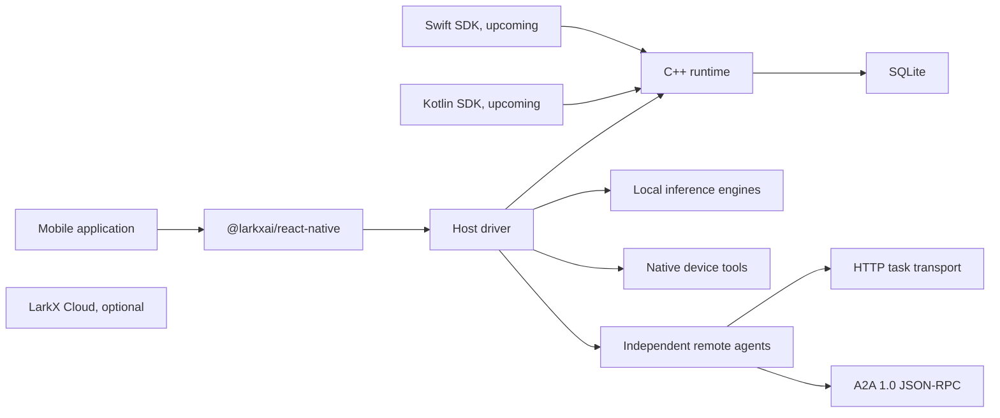

# LarkX

[](https://github.com/larkxai/larkx/actions/workflows/ci.yml)
[](https://github.com/larkxai/larkx/actions/workflows/release.yml)
[](https://www.npmjs.com/package/@larkxai/react-native)
[](./LICENSE)

**The missing execution layer for on-device AI agents.**

LarkX is open-source execution infrastructure for AI agents that run directly on devices, work offline, recover from interruptions, and collaborate with remote agents.

Inference engines run models. LarkX keeps the execution record on the device: the model decision, the tool result, and a remote task identity. When the process starts again, the same agent registration continues the same run.

- Durable agent execution in SQLite.
- Local inference through an optional Cactus adapter.
- Native application tools, with explicit side-effect classes.
- Offline operation. A killed process does not keep running.
- Crash recovery that reuses committed operations.
- Hybrid delegation over HTTP or A2A 1.0. The parent run stays on the device.
- Optional Cloud observability. Telemetry is metadata. It is off by default.

[Website](https://larkx.ai) · [Documentation](https://docs.larkx.ai) · [Cloud](https://cloud.larkx.ai) · [npm](https://www.npmjs.com/package/@larkxai/react-native) · [Releases](https://github.com/larkxai/larkx/releases)

## Start here

| Step                                                          | Where                                                                               |
| ------------------------------------------------------------- | ----------------------------------------------------------------------------------- |
| Install the SDK and make a development build                  | [Installation](https://docs.larkx.ai/getting-started/installation)                  |
| Run a scripted agent. Expected message: `Seal needs service.` | [Hello World](https://docs.larkx.ai/getting-started/hello-world)                    |
| Download `qwen3-0.6b` and run a local model                   | [Your first on-device agent](https://docs.larkx.ai/getting-started/on-device-agent) |
| Delegate one task to a LangGraph agent                        | [Your first hybrid agent](https://docs.larkx.ai/getting-started/hybrid-agent)       |
| Build the field-inspection demo                               | [examples/react-native-agent](examples/react-native-agent/README.md)                |
| Send metadata to Cloud                                        | [Connect your agent](https://docs.larkx.ai/cloud/connecting)                        |
| Physical-device checks and the launch list                    | [docs/validation/on-device-agent.md](docs/validation/on-device-agent.md)            |

Tutorials and the API reference live on the documentation site. This file does not repeat them.

## Public SDK

| Platform     | Distribution                      | Status                                                                   |
| ------------ | --------------------------------- | ------------------------------------------------------------------------ |
| React Native | npm `@larkxai/react-native` 0.4.1 | Available for iOS and Android. Physical-device validation is still open. |
| Swift        | Swift Package Manager             | Upcoming. Not published.                                                 |
| Kotlin       | Maven                             | Upcoming. Not published.                                                 |

```bash
npm install @larkxai/react-native expo-file-system
```

```typescript
import { createRuntime, defineTool, scriptedModel, sqlite } from "@larkxai/react-native";
```

`react` and `react-native` are required peers. `expo-file-system` is a required peer because `sqlite()` with no path stores `larkx.db` in the application documents directory. Expo Go cannot load `LarkXNativeCore`. Use a development build. There is no JavaScript fallback.

Install `cactus-react-native` 1.13.1 and `react-native-nitro-modules` 0.33.9 or newer only when the app imports `@larkxai/react-native/cactus`. The root import does not load Cactus. Install `expo-crypto` only when the app passes `larkxCloud`. Hello World needs neither.

Node.js in this repository is the internal test host. It is not an application install. See [CONTRIBUTING.md](CONTRIBUTING.md).

## Architecture



The C++ runtime owns orchestration, the SQLite record, replay, retries, operation ids, ownership fencing, cancellation, unknown outcomes, reconciliation, and remote delegation state. The host driver performs the model call, tool call, or HTTP request the runtime asked for. It does not plan the next step.

Local inference, native tools, and remote agent frameworks stay outside the core. The repository includes a LangGraph A2A example. It does not ship a Google ADK adapter or an OpenAI Agents SDK adapter. A remote peer is whatever service you register, over the HTTP task protocol or A2A 1.0. LarkX Cloud does not own the local execution record.

Open a new database file. This runtime stamps SQLite `application_id` `LXRT` (`0x4C585254`) on files it creates. A file with any other id is rejected and left unchanged.

## Execution guarantees

- A committed model decision or tool result is replayed. The handler is not called again.
- An interrupted `pure` or `idempotent` call may retry. An idempotent retry keeps its operation id.
- An interrupted `non-idempotent` call is `UNKNOWN_OUTCOME`. The run stays `BLOCKED` until `reconcile`.
- Ownership writes carry an epoch. A stale owner cannot commit.
- Cancellation is explicit. A committed step stays committed.
- An external effect is not exactly-once. The process can die after the effect and before the commit.
- A remote task is not exactly-once. Recovery follows the capabilities stored with the delegation.
- The runtime does not continue executing after the operating system terminates its process.

## Current limitations

- A development build on a physical iPhone or Android phone, real Cactus download and inference, offline tool calling, force-quit recovery, and a phone reaching the LangGraph example are not recorded as passed. The checklist is [docs/validation/on-device-agent.md](docs/validation/on-device-agent.md).
- Process-death tests kill the Node example with `SIGKILL` and reopen the database. They stand in for mobile process death. They are not a phone run.
- `qwen3-0.6b` is the Cactus model name this adapter passes through. Download and initialization happen before the run. This repository has not measured that download on a phone.
- SDK HTTP calls do not follow redirects. The timeout covers the whole attempt. A permanently rejected telemetry run does not block other runs, and that rejection is kept across restart. iOS does not store cookies for these calls. Android `HttpURLConnection` can still attach cookies if the application installed a process-wide `CookieHandler`. See [docs/architecture/telemetry.md](docs/architecture/telemetry.md).
- Production Cloud ingestion from a phone is not verified. `GET https://cloud.larkx.ai/v1/health` returning telemetry version 1 does not prove the deployed collector accepts storage schema 3. The device-side exporter is implemented. Do not send a synthetic batch to production to find out.
- Swift and Kotlin SDKs are not published.

## Examples

| Example                                                                | What it shows                                                                    |
| ---------------------------------------------------------------------- | -------------------------------------------------------------------------------- |
| [examples/react-native-agent](examples/react-native-agent)             | Field-inspection demo against this checkout's 0.4.1 sources                      |
| [examples/langgraph-a2a-agent](examples/langgraph-a2a-agent/README.md) | Independently deployed LangGraph agent with an A2A 1.0 endpoint                  |
| [examples/node-agent](examples/node-agent/README.md)                   | Internal Node host: scripted agent, local tools, SQLite, and process termination |
| [examples/node-hybrid](examples/node-hybrid/README.md)                 | Internal Node host delegating over HTTP or A2A. Not a public SDK                 |
| [examples/remote-task](examples/remote-task/README.md)                 | HTTP task fixture used by the hybrid example. Not a hosted product               |
| [examples/a2a-fixture](examples/a2a-fixture/README.md)                 | A2A 1.0 fixture for failure injection. Not a LangGraph agent                     |
| [examples/swift-agent](examples/swift-agent)                           | Small Swift program that calls the C ABI. It is not a Swift SDK                  |

## Contributing and license

See [CONTRIBUTING.md](CONTRIBUTING.md) and [ROADMAP.md](ROADMAP.md). LarkX is [Apache-2.0](LICENSE).

```bash
pnpm install
pnpm build
pnpm typecheck
pnpm lint
pnpm format:check
pnpm test
cmake -S native -B native/build -DCMAKE_BUILD_TYPE=Release
cmake --build native/build
ctest --test-dir native/build --output-on-failure
sh packages/node/scripts/build-native.sh
node scripts/inspect-published-sdk.mjs
```

Node.js 22.13 or newer. pnpm 10.33.4. The published-package command needs network access. It installs the npm tarball outside this workspace. It does not build an application and it does not run on a device.
