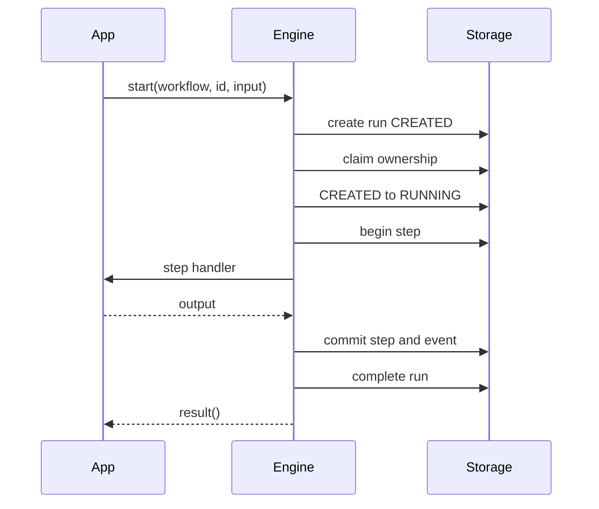

# Execution model

A LarkX run is a stored record plus a workflow function. The function is not a thread the runtime can freeze. On recovery the runtime calls the function again and feeds it the results it already committed.

## Runtime operations

| Operation             | Guarantee                                                                                                                                                   |
| --------------------- | ----------------------------------------------------------------------------------------------------------------------------------------------------------- |
| `start`               | Creates the run id or checks that the existing run has the same workflow name, version, and canonical input. Kicks execution when the status is recoverable |
| `resume`              | Kicks a recoverable run. Does not create a run                                                                                                              |
| `recover`             | `resume` for every recoverable run in storage                                                                                                               |
| `getRun` / `listRuns` | Read stored snapshots. They do not execute                                                                                                                  |
| `cancel`              | Sets a flag and aborts the signal. If no loop is running, claims the run and moves it to `CANCELLED` when that transition is legal                          |
| `subscribe`           | In-process listeners for events stored after the subscription. Missed events are read with `getHistory`                                                     |
| `getHistory`          | The event journal. Not a substitute for step outputs                                                                                                        |
| `getSteps`            | Authoritative step records, including outputs                                                                                                               |
| `reconcileStep`       | Resolves one `UNKNOWN_OUTCOME` step. Does not resume                                                                                                        |
| `close`               | Stops new work, waits for current steps, releases ownership, closes storage                                                                                 |

`result()` on a handle waits for the loop started in this process, then reads storage.

## Capabilities

`engine.capabilities` reports protocol version 1, execution targets `["local"]`, `remoteDispatch: false`, `durableTime: true`, and the storage kind string from the adapter.

## What a crash looks like

If the process dies after a commit, the next process sees `COMPLETED` for that step and skips the handler. If it dies after `begin-step` and before commit, the step is still `RUNNING`. The next resume classifies that interruption from the effect type before any handler runs.

The runtime does not receive a reliable termination callback from the operating system. Recovery infers the interruption from the stored `RUNNING` step.
