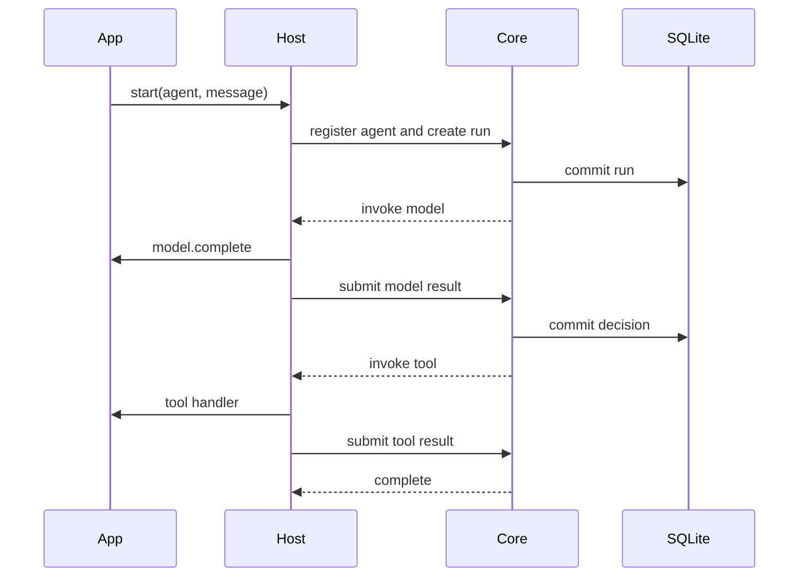

# Execution model

The C++ runtime stores the run and decides the next request. The host performs that request. Recovery reads the stored steps. It does not call a workflow function again.

## Calls

| Call                     | What it does                                                   |
| ------------------------ | -------------------------------------------------------------- |
| `createRuntime`          | Opens the SQLite file and the native session                   |
| `createAgent`            | Registers the agent definition in this process                 |
| `start`                  | Persists a run and schedules the driver, unless `defer` is set |
| `runtime.resume`         | Attaches to a persisted run and schedules recovery             |
| `result`                 | Waits for the terminal agent result in this process            |
| `getStatus` / `listRuns` | Read stored snapshots                                          |
| `cancel`                 | Requests cancellation. A committed step stays committed        |
| `reconcile`              | Resolves one unknown outcome with retry, complete, or fail     |
| `observe`                | In-process diagnostics. A throw does not fail the run          |
| `close`                  | Drops the in-process session. It does not delete the database  |

A `BLOCKED` run stays blocked until `reconcile`. `result()` waits while the host is asking the application to reconcile.
