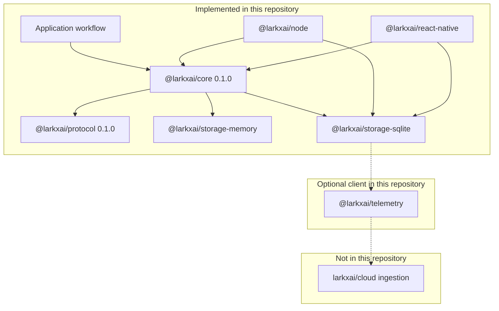

# Cloud observability specification

Status: the batch contract is still what `@larkxai/telemetry` posts. The C++ runtime does not produce the journal. Native export is a later milestone. Sections that name `@larkxai/core`, `defineWorkflow`, the TypeScript storage adapters, or the removed crash tests describe that removed engine. They are historical context for the batch shape, not the current runtime. See [docs/architecture/telemetry.md](architecture/telemetry.md).

Ingestion, accounts, and the dashboard stay in the private `larkxai/cloud` repository. This repository does not contain the Cloud API.

Cloud is a passive observer. It must not start or resume a run, claim ownership, retry a step, reconcile an unknown outcome, cancel a run, or write a step result. Remote workers are not part of this design.

## How to read this document

Sections 1 through 8 describe the removed TypeScript runtime. They are historical. Sections 9 through 13 are the export contract `@larkxai/telemetry` still sends. `larkxai/cloud` accepts it. Section 14 points at JSON fixtures: the `journal` object is a projection of stored rows, and each `telemetryBatches[].body` is the request body. Section 15 separates local execution from Cloud.

Fixture `purpose` values (`full-resync`, `committed-before-recovery`, `checkpoint-suffix`) are labels for the files. They are not fields of the request body.

## 1. Historical repository architecture

LarkX 0.1.0 is a local durable execution engine. A workflow is a TypeScript function. Each durable operation is a step with a caller-supplied key. The runtime stores the step result before it continues. After a crash it calls the function again, returns stored results for completed steps, and either retries or blocks the interrupted step according to its effect class.



| Package                   | Role today                                                                                                                                                                          |
| ------------------------- | ----------------------------------------------------------------------------------------------------------------------------------------------------------------------------------- |
| `@larkxai/protocol`       | Version 1 contracts: states, transitions, effects, event names, error codes, identifiers, JSON values, the unused remote-dispatch request shape, and `RuntimeCapabilities`. No I/O. |
| `@larkxai/core`           | Registration, steps, replay, recovery, ownership fences, the reducer, and the event journal. No model SDK.                                                                          |
| `@larkxai/storage-memory` | The same reducer behind a mutex. `kind` is `"memory"`. Data dies with the process.                                                                                                  |
| `@larkxai/storage-sqlite` | Schema version 1 and the shared SQL adapter. Drivers are injected. `kind` is `"sqlite"`.                                                                                            |
| `@larkxai/node`           | `node:sqlite`, pid-file reclaim, `createNodeEngine`.                                                                                                                                |
| `@larkxai/react-native`   | Expo SQLite through the same driver interface and schema, exclusive ownership, lifecycle binding, local artifact copy, `openReactNativeEngine`.                                     |
| `@larkxai/agent`          | `createAgent` and `defineTool` on the same engine. One local step per model decision and per tool call. No provider SDK.                                                            |
| `@larkxai/cactus`         | Optional `cactus-react-native` 1.13.1 adapter. Not imported by the agent loop or the engine.                                                                                        |
| `@larkxai/testing`        | Fake clocks and storage conformance cases.                                                                                                                                          |
| `@larkxai/telemetry`      | Optional metadata-only exporter. Reads `readJournal`. Posts `/v1/telemetry/batches`. Does not execute workflows.                                                                    |

`@larkxai/protocol`, `@larkxai/core`, `@larkxai/storage-memory`, and `@larkxai/storage-sqlite` do not import `node:*`, `react-native`, `fs`, `path`, or a database driver.

There is one durability log. `workflow_runs` and `workflow_steps` are authoritative. `workflow_events` is an append-only journal written in the same transaction as the state change. Replay does not fold events back into state. The `outbox` table exists for a future dispatcher. The engine does not write it. M2 artifact rows store metadata for a local file copy. They are not execution events, and they are not uploaded.

The public engine surface that exists today is `createEngine` / `createNodeEngine` / `openReactNativeEngine`: `register`, `start`, `resume`, `recover`, `getRun`, `listRuns`, `cancel`, `subscribe`, `getHistory`, `getSteps`, `readJournal`, `reconcileStep`, and `close`. `register` adds a workflow after construction. `subscribe` delivers events to in-process listeners after they are stored. It is not a network subscription. `getHistory` returns the journal. `getSteps` returns authoritative step rows, including outputs. `readJournal` returns the metadata projection the exporter sends. Outputs are not part of that projection.

`engine.capabilities` is:

| Field              | Value in this runtime    |
| ------------------ | ------------------------ |
| `protocolVersion`  | `1`                      |
| `executionTargets` | `["local"]`              |
| `remoteDispatch`   | `false`                  |
| `durableTime`      | `true`                   |
| `storageKind`      | `"memory"` or `"sqlite"` |

Node and React Native both report `storageKind: "sqlite"`. The capabilities object does not name the host platform.

React Native uses the same reducer and schema. `bindReactNativeLifecycle` calls `recover()` when the app becomes active. Background and inactive states do not release ownership. Offline does not fail a local workflow, and coming online only calls `recover()` again. The local runtime does not enter `WAITING`. A killed app resumes the next time it is allowed to run. Native background scheduling is not part of M2.

## 2. Protocol types and schema versions

Three numbers are independent. A mismatch in one does not imply a mismatch in the others.

| Number              | Constant                 | Value          | Meaning                                                                                                                                                                                           |
| ------------------- | ------------------------ | -------------- | ------------------------------------------------------------------------------------------------------------------------------------------------------------------------------------------------- |
| Execution protocol  | `PROTOCOL_VERSION`       | `1`            | States, transitions, event names, and error codes. A stored run executes only when the stored protocol version equals the runtime. `checkProtocolCompatibility` has no compatible-range rule yet. |
| Storage schema      | `STORAGE_SCHEMA_VERSION` | `1`            | SQLite migrations. A newer database than the library refuses to open.                                                                                                                             |
| Workflow definition | `workflow.version`       | Integer `>= 1` | The version registered with `defineWorkflow`. A missing version blocks the run. It is not replayed on a different version.                                                                        |
| Telemetry export    | `TELEMETRY_VERSION`      | `1`            | Batch format in section 9. Independent of the execution protocol and the storage schema. `@larkxai/telemetry` exports the constant.                                                               |

`protocolVersion` is stored on `workflow_runs`. It is copied into `WORKFLOW_CREATED`. It is not a per-event field.

### Identifiers

| Name             | Rule                                                                                                                                                               |
| ---------------- | ------------------------------------------------------------------------------------------------------------------------------------------------------------------ |
| Run id           | 1 to 200 characters. No leading or trailing whitespace. No ASCII control characters, including NUL. Chosen by the caller. Reuse does not start a second execution. |
| Workflow name    | `^[a-z][a-z0-9-]{0,63}$`                                                                                                                                           |
| Handler name     | Same pattern as a workflow name. Used only by the unused remote-dispatch validator.                                                                                |
| Workflow version | Integer `>= 1`                                                                                                                                                     |
| Step key         | `^[A-Za-z0-9][A-Za-z0-9._:-]{0,127}$`. Caller-supplied. Not a source location. Unique within a run.                                                                |

### Status enums

Workflow: `CREATED`, `RUNNING`, `WAITING`, `RECOVERING`, `COMPLETED`, `FAILED`, `CANCELLED`, `BLOCKED`.

Terminal workflow statuses are `COMPLETED`, `FAILED`, and `CANCELLED`. They have no exits. `BLOCKED` is not terminal.

Step: `PENDING`, `RUNNING`, `WAITING_REMOTE`, `RETRY_SCHEDULED`, `COMPLETED`, `FAILED`, `UNKNOWN_OUTCOME`, `CANCELLED`.

Attempt: `STARTED`, `COMPLETED`, `FAILED`, `INTERRUPTED`, `CANCELLED`.

`isRecoverableWorkflowStatus` is true for `CREATED`, `RUNNING`, `WAITING`, and `RECOVERING`. `recover()` and `resume()` kick only those. `BLOCKED` is not in that list.

### Effects, targets, and data policy

Effects: `pure`, `idempotent`, `non-idempotent`.

Execution targets in the type system: `local`, `cloud`, `hybrid`. A remote delegation step is `hybrid`. Other steps stay `local`.

Data policies: `device-only`, `cloud-allowed`. `strictestDataPolicy` returns `device-only` if either side is `device-only`. The engine default is `device-only`. A workflow may set its own policy. The stored run gets the stricter of the two.

A hybrid delegation under `device-only` is rejected before a request is sent. Registering a remote agent stores the run as `cloud-allowed` and writes the outbox row in the same transaction as the delegation. `REMOTE_*` events carry ids and the endpoint, not the arguments or the result. `local` does not mean offline. A local handler may use the network. That use is invisible to the journal except through the handler's success or failure.

### Errors

`ERROR_CODES` in `@larkxai/protocol` is the closed set. `isRetryableErrorCode` is false for every code except `transient_execution_failure`, `network_unavailable`, and `step_timeout`. A `LarkxError` may override `retryable`. A thrown `Error` that is not a `LarkxError` is stored as `transient_execution_failure` with `retryable: true`. Anything else becomes that same code with the message `"Unknown execution error."`

Stored errors are JSON objects `{ code, message, retryable }` on the run, step, or attempt row. The journal carries the code, not the message.

### JSON

`encodeJson` rejects `undefined`, `NaN`, infinities, `bigint`, functions, symbols, and class instances. Object keys are sorted. A step or workflow result of `undefined` is stored as JSON `null`. Two starts match only when their canonical input encodings match. A different input for an existing run id throws `incompatible_run` and does not create another execution.

### Remote dispatch types

`RemoteDispatchRequest`, `RemoteDispatchAcceptance`, and `RemoteTaskResult` are validated shapes. `validateRemoteDispatchRequest` rejects `protocolVersion` other than 1 and rejects `dataPolicy: "device-only"`. The engine never builds or sends these objects. Cloud observability must not implement this request as an ingestion API and must not treat it as permission to execute a step.

## 3. Workflow and step state machines

The tables in `@larkxai/protocol` are the legal transitions. `reduceApply` in `@larkxai/core` is the only writer that applies them. Both storage adapters call that reducer inside a transaction or a mutex. An illegal transition throws `invalid_state_transition` and leaves the previous state in place.

### Workflow

| From                               | To                                                                     |
| ---------------------------------- | ---------------------------------------------------------------------- |
| `CREATED`                          | `RUNNING`, `CANCELLED`, `BLOCKED`                                      |
| `RUNNING`                          | `WAITING`, `RECOVERING`, `COMPLETED`, `FAILED`, `CANCELLED`, `BLOCKED` |
| `WAITING`                          | `RUNNING`, `RECOVERING`, `CANCELLED`, `FAILED`, `BLOCKED`              |
| `RECOVERING`                       | `RUNNING`, `WAITING`, `COMPLETED`, `FAILED`, `CANCELLED`, `BLOCKED`    |
| `BLOCKED`                          | `RUNNING`, `RECOVERING`, `FAILED`, `CANCELLED`                         |
| `COMPLETED`, `FAILED`, `CANCELLED` | none                                                                   |

`WAITING` is reserved for connectivity and remote results. The local runtime does not enter it.

`BLOCKED` means the runtime will not guess. `resume` alone does not move it. `CREATED` becomes `BLOCKED` when the workflow version is not registered or the stored protocol is not 1.

A completion command with `honorCancel: true` is stored as `CANCELLED` when `cancelRequested` is already set. The drafted event type is rewritten to `WORKFLOW_CANCELLED`. The drafted payload is left as it was, which for a normal completion is `{}`.

`FAILED` is not retried in place. A new execution is a new run id.

### Steps

| From                               | To                                                                                         |
| ---------------------------------- | ------------------------------------------------------------------------------------------ |
| `PENDING`                          | `RUNNING`, `CANCELLED`                                                                     |
| `RUNNING`                          | `COMPLETED`, `FAILED`, `WAITING_REMOTE`, `RETRY_SCHEDULED`, `UNKNOWN_OUTCOME`, `CANCELLED` |
| `WAITING_REMOTE`                   | `COMPLETED`, `FAILED`, `RETRY_SCHEDULED`, `UNKNOWN_OUTCOME`, `CANCELLED`                   |
| `RETRY_SCHEDULED`                  | `RUNNING`, `CANCELLED`, `FAILED`                                                           |
| `UNKNOWN_OUTCOME`                  | `RETRY_SCHEDULED`, `COMPLETED`, `FAILED`, `CANCELLED`                                      |
| `COMPLETED`, `FAILED`, `CANCELLED` | none                                                                                       |

`PENDING` and `WAITING_REMOTE` are legal and unused by local execution. The engine inserts a step as `RUNNING` on first begin. It does not insert `PENDING`.

`RUNNING` is not automatically `FAILED` after a crash. The next owner either schedules a retry or records `UNKNOWN_OUTCOME`.

### Attempts

Each entry into a handler inserts an attempt at `STARTED`. Closing it sets `COMPLETED`, `FAILED`, `INTERRUPTED`, or `CANCELLED`, and sets `completedAt`. Attempt numbers start at 1 and increase by 1 on each begin. The operation id does not change.

## 4. Execution journal event types and payloads

`EVENT_TYPES` is the closed set. `workflow_events.event_type` is one of these strings. A stored type outside the set fails the SQLite read with `storage_failure`.

| Type                       | Emitted by this runtime                              | Payload keys actually written                                                                                                                                |
| -------------------------- | ---------------------------------------------------- | ------------------------------------------------------------------------------------------------------------------------------------------------------------ |
| `WORKFLOW_CREATED`         | Yes, once, in `reduceCreateRun`                      | `workflowName`, `workflowVersion`, `protocolVersion`, `dataPolicy`                                                                                           |
| `WORKFLOW_STARTED`         | Yes                                                  | First start: `workflowName`, `workflowVersion`. After recovery: `resumed: true`. After reconcile retry or complete: `stepKey`, `resolution`                  |
| `WORKFLOW_RECOVERED`       | Yes, when a non-`CREATED` recoverable run is claimed | `from` (`RUNNING` or `WAITING`; this runtime only produces `RUNNING`)                                                                                        |
| `WORKFLOW_WAITING`         | No                                                   | None. The name is reserved.                                                                                                                                  |
| `WORKFLOW_BLOCKED`         | Yes                                                  | Unknown outcome: `stepKey`, `code: "unknown_operation_outcome"`. Missing version, protocol mismatch, replay divergence, or history failure: `code` only      |
| `WORKFLOW_COMPLETED`       | Yes                                                  | `{}`                                                                                                                                                         |
| `WORKFLOW_FAILED`          | Yes                                                  | Step failure: `stepKey`, `code`. Failure outside a resolved step: `code` only. Reconcile `fail`: `stepKey`, `resolution: "fail"`                             |
| `WORKFLOW_CANCELLED`       | Yes                                                  | Explicit cancel: `reason: "cancelled"`. Completion rewritten by `honorCancel`: the completion payload, which is `{}`                                         |
| `STEP_STARTED`             | Yes                                                  | `stepKey`, `effects`, `execution: "local"`, `operationId`. No attempt number                                                                                 |
| `STEP_COMPLETED`           | Yes                                                  | `stepKey`, `effects`, `execution: "local"`, `attempt`                                                                                                        |
| `STEP_FAILED`              | Yes, including cancelled steps                       | `stepKey`, `code`, `attemptStatus` (`FAILED` or `CANCELLED`)                                                                                                 |
| `STEP_RETRY_SCHEDULED`     | Yes                                                  | Interruption of `pure` or `idempotent`: `stepKey`, `effects`, `reason: "interrupted"`. Retryable handler error: `stepKey`, `code`, `attemptStatus: "FAILED"` |
| `STEP_OUTCOME_UNKNOWN`     | Yes                                                  | Process interruption: `stepKey`, `effects`, `reason: "interrupted"`. Retryable handler error on `non-idempotent`: `stepKey`, `reason: "uncommitted"`         |
| `STEP_RECONCILED`          | Yes, from `reconcileStep`                            | `stepKey`, `resolution` (`retry`, `fail`, or `complete`)                                                                                                     |
| `REMOTE_DISPATCH_QUEUED`   | No                                                   | None                                                                                                                                                         |
| `REMOTE_DISPATCH_ACCEPTED` | No                                                   | None                                                                                                                                                         |
| `REMOTE_RESULT_RECEIVED`   | No                                                   | None                                                                                                                                                         |

Payloads are JSON objects. The keys above are the ones the engine writes. They are not a schema that accepts arbitrary extra keys from application code. Application code cannot append journal events.

`draft()` runs the payload through `encodePayload`, which sorts object keys. `WORKFLOW_CREATED` is the exception: `reduceCreateRun` assigns the object literal directly, so the on-disk `payload_json` for that one event is insertion order `workflowName`, `workflowVersion`, `protocolVersion`, `dataPolicy`. A read through the storage adapter parses it with `decodeJson`, which sorts keys. Consumers must parse JSON. Key order is not significant.

### Sensitive keys

`SENSITIVE_EVENT_KEYS` is `input`, `output`, `messages`, `prompt`, `toolResult`, and `content`. `appendEvent` rejects a payload that contains one of those keys with `serialization_failure`. The replay test for `count-letters` asserts that `getHistory` does not contain the workflow input or the normalized step output. Those values live on `workflow_runs.input_json`, `workflow_runs.output_json`, and `workflow_steps.output_json`.

Step `input_json` is stored as SQL `NULL` for the local steps this runtime begins. The handler closes over the workflow input. That input is not copied onto the step row.

### What does not become an event

Ownership claim, renewal, and release change `owner_id`, `ownership_epoch`, and `lease_expires_at` without a journal event. `requestCancel` sets `cancel_requested` without a journal event. The cancel event is written later, when the status becomes `CANCELLED`. Heartbeats do not appear in the journal. Artifact imports do not appear in the journal.

Several events from one reducer command commit in one transaction. `mark-unknown` writes `STEP_OUTCOME_UNKNOWN` and `WORKFLOW_BLOCKED` together. A failed step writes `STEP_FAILED` and `WORKFLOW_FAILED` together. A crash cannot expose the first without the second. Separate commands, such as `WORKFLOW_RECOVERED` followed by `WORKFLOW_STARTED`, are separate transactions and can still share a millisecond timestamp.

`createdAt` is the injected clock in milliseconds. It is not a unique order. The success capture below has `STEP_COMPLETED` for `summarize` and `WORKFLOW_COMPLETED` at the same millisecond. Order is `sequence`.

Event ids and operation ids come from `createId`, which defaults to `crypto.randomUUID()`. Attempt ids use the same function. The id format is not a protocol rule. Uniqueness of `event_id`, and of `(run_id, sequence)`, is a storage rule.

## 5. Run identifiers, step keys, operation ids, and retries

A run id is the caller's idempotency key for `start`. The same id, workflow name, version, and canonical input returns the existing run. A different name, version, or input throws `incompatible_run`.

Step order is the zero-based index of `ctx.step` during the first execution. Replay expects the recorded key at that cursor. A different key, a duplicate key at a new index, or a changed `execution` / `effects` pair on a completed step throws `replay_divergence` and blocks the run. The new handler is not called.

The operation id is allocated once, on the first begin of the step, and stored on the step row. Later attempts reuse it. Begin rejects a different operation id with `replay_divergence`. Handlers that need an idempotent external write are supposed to use `StepContext.operationId`. The runtime does not inspect the handler. Repeating a handler that ignores the id is not idempotent, whatever the label says.

`StepContext` also carries `attempt`, `runId`, `stepKey`, `signal`, `workflowName`, and `workflowVersion`. `attempt` is the attempt number. It is not on `STEP_STARTED`. It is on `STEP_COMPLETED` and on the attempt row. Cloud should read attempt identity from the attempt snapshot, not by counting `STEP_STARTED` events, though those events are one per attempt in this runtime.

### Retry policy

`DEFAULT_RETRY` is `maxAttempts: 3`, `initialIntervalMs: 50`, `maxIntervalMs: 30_000`, `backoff: "exponential"`, `factor: 2`.

```text
delay = initialIntervalMs                         when backoff is "fixed"
delay = initialIntervalMs * factor ^ (attempt-1)  when backoff is "exponential"
delay = min(maxIntervalMs, max(0, floor(delay)))
```

`attempt` in that formula is the attempt that just failed. A fixed policy of 5 ms stays 5 ms. An exponential policy of 50 ms waits 50 ms, then 100 ms. A non-finite result uses `maxIntervalMs`.

The handler runs again when `stored.retryable` is true, the effect is `pure` or `idempotent`, and `attemptNumber < maxAttempts`. The third failure of the default policy fails the step and the run. The wait is `clock.sleep`. Tests use an auto clock so the sleep does not block on wall time. `nextAttemptAt` is set on the step while it is `RETRY_SCHEDULED` and cleared on the next begin.

A retryable failure of a `non-idempotent` step does not use this loop. It becomes `UNKNOWN_OUTCOME`. See section 6.

Interruption of `pure` or `idempotent` schedules a retry without consuming the policy's throw-count in a special way: the interrupted attempt is closed as `INTERRUPTED`, and the next begin uses the next attempt number. `nextAttemptAt` is the recovery clock's current time, so the next begin does not wait.

`EngineTermination` is the in-process stand-in for dying before commit. It does not write `FAILED`. The step stays `RUNNING` if begin had already committed. The next `resume` classifies it. Real process death is `SIGKILL` in `tests/crash-recovery/crash.test.ts` and `tests/react-native/restart.test.ts`. Those tests do not print the journal. The event sequences in section 7 were read from the SQLite database of `examples/node-workflow`, which is the process those Node tests spawn.

## 6. Recovery, cancellation, failure, and UNKNOWN_OUTCOME

### Ownership

Every mutating command carries a fence: `ownerId` plus `ownershipEpoch`. The reducer rejects a write when either value differs (`execution_ownership_conflict`).

`create` stores epoch `0` and a null owner. A claim by a new owner increments the epoch and sets the owner. The same owner refreshing a lease keeps the epoch. Release clears the owner, increments the epoch, and clears the lease. Terminal runs cannot be claimed.

`leaseMs: 0` stores `lease_expires_at` as null. A null expiry with a non-null owner is treated as an active lease, not as an expired one. The Node example uses `leaseMs: 30_000` and renews at one third of that interval. Renewal is not journaled.

Node may replace an owner when `mayStealFrom` says the pid in the owner file is dead, and it may also take an expired lease because Node storage is not exclusive. React Native sets `exclusiveOwnership`. An expired lease is not evidence that a suspended JavaScript realm has stopped. A different owner can take the run only when that owner id is absent from the live-owner set on `globalThis`. Force-quit clears that set. A second engine in the same realm cannot take a live owner's run.

Observed epochs from the Node `SIGKILL` captures:

| Situation                 | Epoch after the fact | Owner column                                                 |
| ------------------------- | -------------------- | ------------------------------------------------------------ |
| Clean completion          | `2`                  | null. Claim took it to 1, release took it to 2.              |
| Killed inside a handler   | `1`                  | still the dead owner's id. `finally` did not run.            |
| Recovered after that kill | `3`                  | null. The new process stole epoch 2, then release made it 3. |

`EngineTermination` does run `finally` and release, so a test that uses it will show a higher epoch than `SIGKILL` for the same event sequence. Cloud must not treat the epoch or the owner id as a credential. The proposed export omits the owner id. `ownerPresent` in the fixtures is only `owner_id IS NOT NULL`.

`close()` waits for in-flight steps, releases ownership, and closes storage. It does not fail the run. It must not be called from an engine hook.

### Recovery sequence

`execute` claims, then:

1. If the definition is missing, transition to `BLOCKED` with `WORKFLOW_BLOCKED` and `code: "unknown_workflow_version"`. No `WORKFLOW_STARTED`.
2. If the stored protocol is not 1, the same path with `protocol_incompatible`.
3. If `cancelRequested` is set, transition to `CANCELLED`.
4. If the status is `CREATED`, transition to `RUNNING` with `WORKFLOW_STARTED` and the workflow name and version.
5. If the status is `RUNNING`, `WAITING`, or `RECOVERING`, transition to `RECOVERING` with `WORKFLOW_RECOVERED` unless it is already `RECOVERING`, then transition to `RUNNING` with `WORKFLOW_STARTED` and `resumed: true`.
6. `prepareInterrupted` inspects the last step. Only a last step in `RUNNING` is an interruption. A completed prefix is left alone.
7. The workflow function runs from the beginning. Completed steps return stored output and do not call the handler.

A crash after commit leaves that step `COMPLETED`. A crash after begin and before commit leaves it `RUNNING`. The runtime does not get a reliable termination callback from the operating system.

### Effect classes after interruption or a thrown error

| Class            | Last step still `RUNNING` at recovery                                                   | Retryable throw or `step_timeout` during the handler                                               |
| ---------------- | --------------------------------------------------------------------------------------- | -------------------------------------------------------------------------------------------------- |
| `pure`           | Attempt `INTERRUPTED`, step `RETRY_SCHEDULED`, then the handler may run again           | Attempt `FAILED`, step `RETRY_SCHEDULED`, wait, begin again, until `maxAttempts`                   |
| `idempotent`     | Same as `pure`, and the operation id is unchanged                                       | Same as `pure`, same operation id                                                                  |
| `non-idempotent` | Step `UNKNOWN_OUTCOME`, run `BLOCKED`, attempt `INTERRUPTED`. The handler is not called | Step `UNKNOWN_OUTCOME`, run `BLOCKED`, attempt `INTERRUPTED`. Reason in the event is `uncommitted` |

A non-retryable `LarkxError` on a `pure` or `idempotent` step fails that step and the run. The handler is not retried. `FAILED` has no exit.

Exactly-once external effects are not a guarantee. The effect can happen and the process can die before commit.

### UNKNOWN_OUTCOME and reconcile

`mark-unknown` allows the step source status `RUNNING` or `WAITING_REMOTE`. Local execution only produces it from `RUNNING`. The run moves to `BLOCKED` unless it is already `BLOCKED`. `blocked_reason` is a JSON string `{ code, message }`. The run's `error_json` stays null. The step's `error_json` is a stored error with `code: "unknown_operation_outcome"` and `retryable: false`.

`BLOCKED` is not returned by `listRecoverableRuns`. A later `resume` does not append events.

`reconcileStep` is the local application's way out. It is not a Cloud API. It claims the run, writes one command, and releases. It does not call the workflow function.

| Resolution | Step                                          | Run                                | Events                                                                                                                 |
| ---------- | --------------------------------------------- | ---------------------------------- | ---------------------------------------------------------------------------------------------------------------------- |
| `retry`    | `RETRY_SCHEDULED`, `nextAttemptAt` set to now | `RUNNING`, `blockedReason` cleared | `STEP_RECONCILED` `{ stepKey, resolution: "retry" }`, then `WORKFLOW_STARTED` `{ stepKey, resolution: "retry" }`       |
| `complete` | `COMPLETED` with the supplied output          | `RUNNING`                          | `STEP_RECONCILED` `{ stepKey, resolution: "complete" }`, then `WORKFLOW_STARTED` `{ stepKey, resolution: "complete" }` |
| `fail`     | `FAILED`                                      | `FAILED`                           | `STEP_RECONCILED` `{ stepKey, resolution: "fail" }`, then `WORKFLOW_FAILED` `{ stepKey, resolution: "fail" }`          |

The caller must `resume` after `retry` or `complete` if the workflow should continue. That resume appends `WORKFLOW_RECOVERED` and `WORKFLOW_STARTED` with `resumed: true` because the run is `RUNNING`, then begins the step. Reconcile does not itself retry the handler.

### Cancellation

`cancel` sets `cancel_requested` and aborts the run's `AbortSignal`. `COMPLETED` and `FAILED` reject cancel with `invalid_state_transition`. `CANCELLED` is a no-op.

If a loop is running, the loop notices at the next step boundary or at workflow completion. If no loop is running, cancel claims the run and writes `WORKFLOW_CANCELLED` with `{ reason: "cancelled" }` when the transition is legal.

A handler that returns after the signal has aborted is still committed: `STEP_COMPLETED`, then the next boundary writes `WORKFLOW_CANCELLED`. The following step does not start. This is what the cooperative cancel test's handler shape does when the abort listener resolves the promise.

A handler that fails because the signal aborted is resolved as step status `CANCELLED`, attempt status `CANCELLED`, and a journal event whose type is `STEP_FAILED` with `{ stepKey, code: "cancelled_execution", attemptStatus: "CANCELLED" }`. The run then becomes `CANCELLED`. There is no `STEP_CANCELLED` event type.

Cancellation does not compensate. A committed step stays committed. A handler that ignores `signal` can still perform an external effect after the attempt is recorded as cancelled.

### Other blocks and failures

| Condition                                                             | Run status               | Journal                                                                         |
| --------------------------------------------------------------------- | ------------------------ | ------------------------------------------------------------------------------- |
| Unknown workflow version or protocol mismatch before start            | `BLOCKED` from `CREATED` | `WORKFLOW_BLOCKED` `{ code }`                                                   |
| `replay_divergence` or `history_integrity` during replay              | `BLOCKED`                | `WORKFLOW_BLOCKED` `{ code }`                                                   |
| `permission_denied` or `unsupported_capability` from a non-local step | `FAILED`                 | `WORKFLOW_FAILED` `{ code }`. No `STEP_STARTED`, because begin has not happened |
| Permanent step failure                                                | `FAILED`                 | `STEP_FAILED` then `WORKFLOW_FAILED` `{ stepKey, code }`                        |
| Non-idempotent unknown outcome                                        | `BLOCKED`                | `STEP_OUTCOME_UNKNOWN` then `WORKFLOW_BLOCKED`                                  |

Only the last step may be incomplete. An earlier incomplete step is `history_integrity` and blocks the run.

## 7. Representative sequences from M2 tests

The fixtures in `docs/fixtures/cloud-observability/` hold the full journals. This section is the event-type spine and the payload that distinguishes each case. Identifiers in the fixtures are stable stand-ins. The `createdAt` deltas on the `SIGKILL` fixtures match one local capture of `examples/node-workflow`. The failed fixture uses `createAutoClock(1700000000000)`, so every timestamp in that run is the same instant.

Workflow input and step output are not in these sequences. The success capture's handler did return the normalized text and the idempotent operation id. `getHistory` did not contain them. The idempotent capture's completed output used the same operation id as both `STEP_STARTED` events for `summarize`. That equality is visible in the fixture without the output body.

### Successful workflow

Source: uninterrupted `count-letters` run, the workflow in `tests/crash-recovery/crash.test.ts`. Fixture: `successful-workflow.json`. Final status `COMPLETED`, ownership epoch `2`.

```text
1  WORKFLOW_CREATED     workflowName, workflowVersion, protocolVersion, dataPolicy
2  WORKFLOW_STARTED     workflowName, workflowVersion
3  STEP_STARTED         normalize, pure, local, operationId
4  STEP_COMPLETED       normalize, attempt 1
5  STEP_STARTED         count, pure, local, operationId
6  STEP_COMPLETED       count, attempt 1
7  STEP_STARTED         summarize, idempotent, local, operationId
8  STEP_COMPLETED       summarize, attempt 1
9  WORKFLOW_COMPLETED   {}
```

Each handler ran once. A second `start` with the same id and canonical input does not append events and does not call the handlers again.

### Interrupted and recovered workflow

Source: `examples/node-workflow --crash-during count`, then a second process. The invocation log was `normalize`, `count`, `count`, `summarize`. The same classification is what `tests/crash-recovery/crash.test.ts` and the pure-step case in `tests/react-native/restart.test.ts` assert. Fixture: `interrupted-recovered-workflow.json`.

After `SIGKILL` the durable prefix is sequences 1 through 5. The run is `RUNNING`, `count` is `RUNNING`, its attempt is `STARTED`, and the owner column is still set. Epoch is `1`.

```text
6  WORKFLOW_RECOVERED       from: RUNNING
7  WORKFLOW_STARTED         resumed: true
8  STEP_RETRY_SCHEDULED     count, effects: pure, reason: interrupted
9  STEP_STARTED             count, same operationId as sequence 5
10 STEP_COMPLETED           count, attempt 2
11 STEP_STARTED             summarize
12 STEP_COMPLETED           summarize, attempt 1
13 WORKFLOW_COMPLETED       {}
```

`normalize` has one attempt. `count` attempt 1 is `INTERRUPTED` with stored code `transient_execution_failure`. Attempt 2 is `COMPLETED`. The handler for `normalize` does not run on the second process.

### Failed workflow

Source: the permanent pure failure in `tests/engine/effects.test.ts`. Fixture: `failed-workflow.json`. One attempt. Status `FAILED`. Epoch `2`.

```text
1 WORKFLOW_CREATED
2 WORKFLOW_STARTED
3 STEP_STARTED          work, pure
4 STEP_FAILED           code: permanent_execution_failure, attemptStatus: FAILED
5 WORKFLOW_FAILED       stepKey: work, code: permanent_execution_failure
```

Sequences 4 and 5 are one reducer command. The thrown message stays on the step and attempt rows and is not in the fixture.

### Retried idempotent operation

Source: `examples/node-workflow --crash-during summarize`, then a second process. The invocation log was `normalize`, `count`, `summarize`, `summarize`. The operation id on the completed output equalled the operation id on both `STEP_STARTED` events for `summarize`. That is the same rule `tests/react-native/restart.test.ts` asserts for an idempotent record step, and the same rule `tests/engine/replay.test.ts` asserts when an idempotent step is interrupted with `EngineTermination`. Fixture: `retried-idempotent-operation.json`.

```text
7  STEP_STARTED             summarize, effects: idempotent, operationId O
8  WORKFLOW_RECOVERED       from: RUNNING
9  WORKFLOW_STARTED         resumed: true
10 STEP_RETRY_SCHEDULED     summarize, effects: idempotent, reason: interrupted
11 STEP_STARTED             summarize, effects: idempotent, operationId O
12 STEP_COMPLETED           summarize, attempt 2
13 WORKFLOW_COMPLETED
```

Attempt 1 is `INTERRUPTED`. Attempt 2 is `COMPLETED`. `O` is one id.

A retryable throw inside one process, from the flaky pure step in `tests/engine/effects.test.ts`, uses the other `STEP_RETRY_SCHEDULED` payload. An idempotent step that throws `Error` once and then succeeds produced:

```text
STEP_STARTED            operationId O, attempt row 1
STEP_RETRY_SCHEDULED    code: transient_execution_failure, attemptStatus: FAILED
STEP_STARTED            operationId O
STEP_COMPLETED          attempt 2
WORKFLOW_COMPLETED
```

The delay came from the retry policy. With `initialIntervalMs: 1000` and exponential factor 2, the second attempt's `createdAt` was 1000 ms later on the auto clock. That throw-retry is not a separate fixture. Cloud must accept both `STEP_RETRY_SCHEDULED` payloads.

### Blocked non-idempotent operation

Source: `examples/node-workflow --workflow charge-once --crash-during charge`, then a second process. The second process reported status `BLOCKED`. The invocation log was `charge` once. The same outcome is asserted by `tests/crash-recovery/crash.test.ts` and `tests/react-native/restart.test.ts`. Fixture: `blocked-non-idempotent-operation.json`.

```text
1 WORKFLOW_CREATED
2 WORKFLOW_STARTED
3 STEP_STARTED            charge, non-idempotent, operationId O
4 WORKFLOW_RECOVERED      from: RUNNING
5 WORKFLOW_STARTED        resumed: true
6 STEP_OUTCOME_UNKNOWN    effects: non-idempotent, reason: interrupted, stepKey: charge
7 WORKFLOW_BLOCKED        code: unknown_operation_outcome, stepKey: charge
```

Sequences 6 and 7 are one transaction. The step is `UNKNOWN_OUTCOME`. The attempt is `INTERRUPTED`. The run's `error_json` is null. `blocked_reason` on the row contains a message. The fixture keeps only the code `unknown_operation_outcome`. A further `resume` appends nothing.

The non-idempotent handler failure in `tests/engine/effects.test.ts` does this in the same process, without `WORKFLOW_RECOVERED`:

```text
STEP_OUTCOME_UNKNOWN    reason: uncommitted, stepKey
WORKFLOW_BLOCKED        code: unknown_operation_outcome, stepKey
```

That payload has no `effects` key. Cloud must not require `effects` on `STEP_OUTCOME_UNKNOWN`.

If the application later calls `reconcileStep(..., { resolution: "retry" })` and then `resume`, the local journal continues. Cloud does not request that. A local retry resolution followed by resume produced this continuation after sequence 7, with the same operation id:

```text
8  STEP_RECONCILED       resolution: retry
9  WORKFLOW_STARTED      resolution: retry, stepKey
10 WORKFLOW_RECOVERED    from: RUNNING
11 WORKFLOW_STARTED      resumed: true
12 STEP_STARTED          same operationId
```

Sequences 8 and 9 are the reconcile command. Sequences 10 and 11 are the separate resume. They are not in the blocked fixture.

## 8. SQLite journal structure and event ordering

Schema version 1 is created by `migrate` in `@larkxai/storage-sqlite`. Node and React Native both call it. There is no React Native-specific table. Foreign keys are on. The driver sets `busy_timeout` to 5000 and `synchronous` to `NORMAL`, and sets WAL when the library accepts it. Writes use `BEGIN IMMEDIATE`. A failed command rolls back.

| Table               | Role                                                                                |
| ------------------- | ----------------------------------------------------------------------------------- |
| `schema_migrations` | `version`, `applied_at`                                                             |
| `workflow_runs`     | Authoritative run. Primary key `run_id`                                             |
| `workflow_steps`    | Authoritative step. Primary key `(run_id, step_key)`. Unique `(run_id, step_order)` |
| `step_attempts`     | Attempt log. Primary key `attempt_id`. Unique `(run_id, step_key, attempt_number)`  |
| `workflow_events`   | Append-only journal. Primary key `event_id`. Unique `(run_id, sequence)`            |
| `outbox`            | Unused by the engine. Unique `operation_id`                                         |
| `artifacts`         | Local artifact metadata. Not referenced by the journal                              |

`workflow_events` columns: `event_id`, `run_id`, `sequence`, `event_type`, `payload_json`, `created_at`.

Load order:

| Rows     | SQL order                                     |
| -------- | --------------------------------------------- |
| Events   | `ORDER BY sequence ASC`                       |
| Steps    | `ORDER BY step_order ASC`                     |
| Attempts | `ORDER BY attempt_number ASC, attempt_id ASC` |
| Outbox   | `ORDER BY created_at ASC, message_id ASC`     |
| Run list | `ORDER BY created_at ASC, run_id ASC`         |

Index `idx_workflow_events_run` is `(run_id, sequence)`.

On `apply`, the adapter checks that the new event array is a prefix extension of the old one: same `eventId` and `sequence` at every existing index, and no shorter history. It then updates the run row, deletes and reinserts that run's steps, attempts, and outbox from the reduced state, and inserts only `events.slice(previousLength)`. Events are not rewritten. A crash mid-transaction leaves the previous prefix. Steps can move (`RUNNING` to `COMPLETED`) because those rows are replaced. Events only grow.

`payload_json` is `JSON.stringify` of the in-memory payload. The success capture stored `WORKFLOW_CREATED` as:

```json
{
  "workflowName": "count-letters",
  "workflowVersion": 1,
  "protocolVersion": 1,
  "dataPolicy": "device-only"
}
```

`STEP_STARTED` was stored with sorted keys (`effects`, `execution`, `operationId`, `stepKey`) because it passed through `encodePayload`.

`created_at` is an integer millisecond clock. It does not order events. `sequence` does, and it starts at 1 with no gaps. The reducer assigns `events.length + 1` and rejects a non-contiguous in-memory history with `history_integrity`.

The run's `updated_at` can be later than the last event. Release touches the run after the completion event. In the success capture the last event was at offset 9 ms and `updated_at` was at offset 10 ms.

Memory storage runs the same reducer and the same prefix check. It has no SQL. Crash recovery is a SQLite behavior.

## 9. Versioned telemetry export protocol

`@larkxai/telemetry` sends this document. `larkxai/cloud` stores it. Adding a field later must not change reducer behavior, and it needs a new `telemetryVersion` after both repositories agree.

`telemetryVersion` is `1`. It is not `PROTOCOL_VERSION` and not `STORAGE_SCHEMA_VERSION`. A batch carries all three so a consumer can refuse a journal it does not understand.

The exporter reads `readJournal`. It does not open a second log inside the workflow engine and it does not query private SQLite workflow tables. The execution journal remains the source. The checkpoint of what Cloud has acknowledged is exporter state, outside `workflow_events`, and it is not an execution event.

Export is pull-shaped from the device's point of view: the device sends when it can. Cloud does not call the device, and the response contains no command, cursor to execute, or reconcile instruction. Delivery is at least once. Execution does not wait for an acknowledgement. A device that never connects still completes, fails, or blocks locally.

### Batch body

`telemetryBatches[].body` in the fixtures is this document. `purpose` is not part of it.

| Field                   | Meaning                                                                                                    |
| ----------------------- | ---------------------------------------------------------------------------------------------------------- |
| `telemetryVersion`      | `1`                                                                                                        |
| `protocolVersion`       | Copied from the run. Must be `1` for this document.                                                        |
| `storageSchemaVersion`  | `1`, the schema the exporter read.                                                                         |
| `batchId`               | Idempotency key for this POST. A UUID from the exporter. Not an event id.                                  |
| `exportedAt`            | Exporter clock in milliseconds. Not a journal timestamp.                                                   |
| `mode`                  | `"metadata-only"`. The only mode defined here.                                                             |
| `source.installationId` | Host-supplied id for this app installation. Not a user id, not an owner id, and not present in M2 storage. |
| `source.appId`          | Host-supplied application id. Not present in M2 storage.                                                   |
| `source.runtime`        | `"node"` or `"react-native"`, supplied by the host. Not a field of `RuntimeCapabilities`.                  |
| `runs[]`                | One or more run snapshots plus the events included in this batch.                                          |

Each run object copies the metadata projection: `runId`, `workflowName`, `workflowVersion`, `status`, `dataPolicy`, `protocolVersion`, `createdAt`, `updatedAt`, `cancelRequested`, `ownershipEpoch`, `ownerPresent`, `errorCode`, `errorRetryable`, `blockedReasonCode`, `fromSequence`, `throughSequence`, `steps`, `attempts`, and `events`.

`fromSequence` is the sequence of the first event in this batch. `throughSequence` is the sequence of the last. For a full resend they are `1` and the current maximum. For a checkpoint suffix, `fromSequence` is `acknowledged + 1`. The step and attempt arrays are a snapshot of current authoritative rows, not a history of every past status. A later batch replaces that snapshot. Events are not a snapshot. They append.

Step and attempt objects are the metadata projection: identity, status, effect, target, operation id, attempt number, descriptor (`execution`, `effects`, `timeoutMs`), timestamps, and error code plus the `retryable` boolean. They omit input, output, error message, owner id, and local file paths.

Event objects match `ExecutionEventRecord`: `eventId`, `runId`, `sequence`, `type`, `payload`, `createdAt`.

### Acceptance rules for version 1

- `telemetryVersion` must be 1. Any other value is rejected. Compatible evolution is not defined, matching the execution protocol's current strictness.
- `protocolVersion` and `storageSchemaVersion` must be 1.
- `mode` must be `metadata-only`.
- `type` must be one of `EVENT_TYPES`, including the four names this runtime does not emit. An unknown type is rejected. A future event name is not accepted under version 1. See section 13.
- Payload values are JSON. A payload key in `SENSITIVE_EVENT_KEYS` is rejected. Unknown payload keys on a known event type are ignored, not stored as a reason to execute anything.
- `sequence` values inside one run are unique and, together with what Cloud already has, contiguous from 1. Gaps reject the batch.
- The same `(installationId, runId, sequence)` with the same `eventId` and the same parsed payload is a duplicate.
- The same sequence with a different `eventId` or payload is a conflict. The batch is not applied.
- Cloud stores the projection. It does not store a fence it could present back to a device.

## 10. Batch ingestion API

No route exists in this repository. `larkxai/cloud` implements it. `@larkxai/telemetry` calls it.

```http
POST /v1/telemetry/batches
Content-Type: application/json
Idempotency-Key: <batchId>
Authorization: Bearer lkx_ing_...
```

The body is the batch in section 9. `Idempotency-Key` equals `batchId`. A repeated key with the same canonical body returns the original success response. A repeated key with a different body is `invalid_batch`. The bearer token is a project ingestion key. It is not a workflow owner id. `source.installationId` is a separate field. Cloud may bind a key to one installation; a mismatch is `401`.

Success, including a full duplicate of a batch Cloud already applied:

```json
{
  "telemetryVersion": 1,
  "batchId": "00000000-0000-4000-8000-00000000b001",
  "results": [
    {
      "runId": "letters-run",
      "status": "accepted",
      "acceptedThroughSequence": 9,
      "duplicateSequences": []
    }
  ]
}
```

`acceptedThroughSequence` is the highest contiguous sequence Cloud has for that installation and run after the transaction. `duplicateSequences` lists sequences in this batch that matched the stored prefix. The body contains no `actions` array.

Errors, also not `ERROR_CODES`:

| HTTP | `error`             | When                                                                                                                                                                      |
| ---- | ------------------- | ------------------------------------------------------------------------------------------------------------------------------------------------------------------------- |
| 400  | `invalid_batch`     | Missing field, bad identifier, `telemetryVersion` other than 1, `mode` other than `metadata-only`, or `fromSequence` / `throughSequence` inconsistent with the event list |
| 401  | `unauthorized`      | Missing or rejected credential                                                                                                                                            |
| 409  | `history_conflict`  | Sequence already stored with a different event id or payload. Body includes `runId` and `sequence`                                                                        |
| 409  | `sequence_gap`      | The batch would leave a hole. Body includes `runId`, `haveThroughSequence`, and `expectedSequence`                                                                        |
| 413  | `batch_too_large`   | More than 500 events or a body larger than 256 KiB                                                                                                                        |
| 422  | `sensitive_payload` | A payload contains a sensitive key                                                                                                                                        |

The limits are the Cloud limits. The exporter uses the same caps. A conflict or a gap rolls back the whole batch. Cloud does not apply a suffix after a bad prefix.

`GET` of a run, if Cloud offers one for its own operators, returns the stored projection. It is not an API the device is required to call, and it is not a way to repair a device.

## 11. Event deduplication and offline synchronization

The local journal is already durable. Connectivity is not required for execution. The exporter's job is to copy a prefix that already committed.

The exporter stores `acceptedThroughSequence` per run and per destination. On the next flush it sends events with `sequence` greater than that value, plus the current run, step, and attempt snapshot. The same unacknowledged body is retried with the same `batchId`. If the checkpoint is lost, the next flush sends the journal from sequence 1. Both shapes are in the crash fixtures.

| Fixture field               | What Cloud should do                                                                                                                           |
| --------------------------- | ---------------------------------------------------------------------------------------------------------------------------------------------- |
| `committed-before-recovery` | Ingest the prefix that existed at process death. Status may be `RUNNING` with an open attempt.                                                 |
| `full-resync`               | Ingest every event from sequence 1. Sequences already stored must match. New sequences append. The snapshot moves forward to the final status. |
| `checkpoint-suffix`         | Apply only when Cloud already has `fromSequence - 1`. Otherwise `sequence_gap`. The snapshot is still the latest authoritative projection.     |

Apply rule inside one transaction:

1. Load the stored events for `(installationId, runId)` ordered by `sequence`.
2. Walk the batch events in ascending `sequence`.
3. A sequence less than or equal to the stored maximum must match `eventId` and parsed payload. Record it as a duplicate.
4. The next new sequence must be `storedMaximum + 1`. Anything higher is a gap.
5. On a match failure or a gap, commit nothing.
6. On success, append the new events. Replace the run, step, and attempt snapshot only when `throughSequence` is greater than or equal to the stored high-water mark. A replay of an older prefix must not move a `COMPLETED` snapshot back to `RUNNING`.

`eventId` is unique per installation. Two runs must not share an event id. Deduplication is still on `(installationId, runId, sequence)` first, because that is the journal's order key. A repeated `batchId` with the same body returns the original success response and does not append twice.

Ordering across batches follows `sequence`, never `createdAt` and never arrival time. A suffix that arrives before the prefix is a gap, not a cue to invent the missing events.

Out of order clocks are normal. Recovery uses a new process clock. Fixtures rebase one capture onto `1700000000000` and keep the original deltas, including ties. Cloud must not sort a run by `createdAt`.

The exporter treats acknowledgement as the only Cloud response it understands. Extra properties are ignored. A response cannot resume, reconcile, or cancel a run. If Cloud is unreachable, the checkpoint stays where it was and the same body is retried with the same `batchId`. The execution engine is not involved in that retry. A `401`, and a held `400`, `409`, `413`, or `422`, are not retried by the foreground timer. The next manual `flush()` tries once.

## 12. Privacy and metadata-only telemetry defaults

The default data policy is `device-only`. That policy forbids remote dispatch of step inputs. It is enforced today. Telemetry is a different channel and it is off until a host constructs an exporter. When an exporter is configured, the only defined mode is `metadata-only`. Payloads are copied through an allowlist of keys the runtime already stores. Sensitive keys are not selected and then removed.

Metadata-only includes statuses, names, versions, step keys, effect classes, execution target, operation ids, attempt numbers, event types, error codes, the `retryable` boolean, sequences, and timestamps.

Metadata-only excludes:

- Workflow input and output.
- Step input and output.
- Stored error messages and blocked-reason messages. Handler messages can contain user data. The permanent-failure test's message is a one-line example of why the message stays on the device.
- Payload keys `input`, `output`, `messages`, `prompt`, `toolResult`, and `content`.
- Prompts, model responses, tool results, and chain-of-thought. The journal already refuses those keys. The exporter must refuse them again.
- Artifact bytes, `local_uri`, and `remote_reference`. M2 artifact rows point at application storage. They are not telemetry.
- Owner ids and lease deadlines. `ownershipEpoch` and `ownerPresent` are the only ownership facts in the snapshot.

`cloud-allowed` does not add inputs, outputs, or prompts to this export. It only changes whether a future dispatcher would be allowed to send a step. This runtime still refuses that dispatcher. Observability of a `device-only` run is limited to the metadata projection above. There is no second mode in this specification.

Installation and application ids are labels the host chooses. They should not be account emails or user names. The fixtures use `installation-example` and `example-app`.

## 13. Agent runs and the existing journal

M3 records agents with the event types that already exist. There is still no `AGENT_*` event in `EVENT_TYPES`. Cloud must not invent those types or require them for ingestion. No `telemetryVersion` bump is proposed. Coordinate before adding one.

An agent run is a normal workflow run:

| Cloud field                                 | Where it already is                                                                                                                      |
| ------------------------------------------- | ---------------------------------------------------------------------------------------------------------------------------------------- |
| Agent name and version                      | `workflowName`, `workflowVersion`                                                                                                        |
| Run id                                      | `runId`                                                                                                                                  |
| Model and tool steps                        | `stepKey`. The agent package uses `model-<iteration>` and `tool-<iteration>-<index>`. These are ordinary step keys, not a protocol enum. |
| Effect, attempt, operation id               | Existing step and attempt rows, and the existing event payloads                                                                          |
| Duration                                    | `startedAt` and `completedAt` on the attempt row                                                                                         |
| Retry, recovery, blocked, failed, completed | `STEP_RETRY_SCHEDULED`, `WORKFLOW_RECOVERED`, `STEP_OUTCOME_UNKNOWN`, `WORKFLOW_BLOCKED`, `WORKFLOW_FAILED`, `WORKFLOW_COMPLETED`        |

Provider id and model id are fields on the model step output (`provider`, `model`). That output also contains the assistant text and the tool-call arguments. Metadata-only export still excludes step output. Do not upload user messages, model responses, tool arguments, tool outputs, or artifacts by default. They are not in the journal today, and M3 does not put them there.

The exporter does not read `provider` or `model` out of that output, and it does not promote tool names into the batch. A compatible extension would add a new non-sensitive field in `@larkxai/protocol`, bump `telemetryVersion`, and land in `larkxai/cloud` before this client sends it. That extension is not part of version 1.

Unchanged rules:

- One durable step per model decision and per tool call. No second durability log.
- Replay of a committed decision does not call the model again. Cloud must not call a model to fill in a run.
- A non-idempotent tool that is interrupted is `UNKNOWN_OUTCOME` and `BLOCKED`. Cloud must not retry it.
- Operation ids stay stable across retries of a step.
- Payloads continue to reject `input`, `output`, `messages`, `prompt`, `toolResult`, and `content`.
- New event names are added to `EVENT_TYPES` first. They need a new `telemetryVersion`.
- Existing type names and their current payloads keep their meaning.
- `REMOTE_*` events now record delegation ids. They still must not carry prompts, arguments, or results. Cloud must not execute the remote agent.

Local agent execution does not read Cloud credentials. This repository contains the exporter. It does not contain the ingestion service or the dashboard.

## 14. Example telemetry payloads

The normative examples are the fixtures:

| File                                                                      | Final status | Batches                     |
| ------------------------------------------------------------------------- | ------------ | --------------------------- |
| `docs/fixtures/cloud-observability/successful-workflow.json`              | `COMPLETED`  | `full-resync`               |
| `docs/fixtures/cloud-observability/interrupted-recovered-workflow.json`   | `COMPLETED`  | prefix, full resync, suffix |
| `docs/fixtures/cloud-observability/failed-workflow.json`                  | `FAILED`     | `full-resync`               |
| `docs/fixtures/cloud-observability/retried-idempotent-operation.json`     | `COMPLETED`  | prefix, full resync, suffix |
| `docs/fixtures/cloud-observability/blocked-non-idempotent-operation.json` | `BLOCKED`    | prefix, full resync, suffix |

`fixtureFormat` is `1`. `classification.journal` is `implemented`. `classification.telemetryBatches` is `proposed`. The request body Cloud would receive is `telemetryBatches[].body`.

The failed full-resync body is the smallest complete example. Its events are the engine's `getHistory` output for that run:

```json
{
  "telemetryVersion": 1,
  "protocolVersion": 1,
  "storageSchemaVersion": 1,
  "batchId": "00000000-0000-4000-8000-00000000b301",
  "exportedAt": 1700000000000,
  "mode": "metadata-only",
  "source": {
    "installationId": "installation-example",
    "appId": "example-app",
    "runtime": "node"
  },
  "runs": [
    {
      "runId": "perm-1",
      "workflowName": "permanent",
      "workflowVersion": 1,
      "status": "FAILED",
      "dataPolicy": "device-only",
      "protocolVersion": 1,
      "cancelRequested": false,
      "ownershipEpoch": 2,
      "ownerPresent": false,
      "errorCode": "permanent_execution_failure",
      "errorRetryable": false,
      "blockedReasonCode": null,
      "fromSequence": 1,
      "throughSequence": 5
    }
  ]
}
```

The run object in the file also carries `createdAt`, `updatedAt`, `steps`, `attempts`, and `events`. The step projection for that failure is status `FAILED`, effect `pure`, attempt count `1`, and the same error code. The attempt is status `FAILED`.

Payloads Cloud will see on the M2 paths, copied from the captures and the effect tests:

```json
{
  "WORKFLOW_CREATED": {
    "workflowName": "count-letters",
    "workflowVersion": 1,
    "protocolVersion": 1,
    "dataPolicy": "device-only"
  },
  "WORKFLOW_STARTED_first": {
    "workflowName": "count-letters",
    "workflowVersion": 1
  },
  "WORKFLOW_STARTED_resumed": { "resumed": true },
  "WORKFLOW_RECOVERED": { "from": "RUNNING" },
  "STEP_STARTED": {
    "effects": "idempotent",
    "execution": "local",
    "operationId": "00000000-0000-4000-8000-000000004103",
    "stepKey": "summarize"
  },
  "STEP_COMPLETED": {
    "attempt": 2,
    "effects": "idempotent",
    "execution": "local",
    "stepKey": "summarize"
  },
  "STEP_RETRY_SCHEDULED_interrupted": {
    "effects": "idempotent",
    "reason": "interrupted",
    "stepKey": "summarize"
  },
  "STEP_RETRY_SCHEDULED_thrown": {
    "attemptStatus": "FAILED",
    "code": "transient_execution_failure",
    "stepKey": "save"
  },
  "STEP_FAILED": {
    "attemptStatus": "FAILED",
    "code": "permanent_execution_failure",
    "stepKey": "work"
  },
  "STEP_OUTCOME_UNKNOWN_interrupted": {
    "effects": "non-idempotent",
    "reason": "interrupted",
    "stepKey": "charge"
  },
  "STEP_OUTCOME_UNKNOWN_uncommitted": {
    "reason": "uncommitted",
    "stepKey": "send"
  },
  "WORKFLOW_BLOCKED": {
    "code": "unknown_operation_outcome",
    "stepKey": "charge"
  },
  "WORKFLOW_FAILED_step": {
    "code": "permanent_execution_failure",
    "stepKey": "work"
  },
  "WORKFLOW_COMPLETED": {},
  "WORKFLOW_CANCELLED": { "reason": "cancelled" }
}
```

The operation id in `STEP_STARTED` above is the fixture id for `summarize` in the idempotent file. Both `STEP_STARTED` events for that step use it.

## 15. Implemented behavior and proposed behavior

| Topic                | Implemented now                                                                           | Proposed for Cloud                                                                               |
| -------------------- | ----------------------------------------------------------------------------------------- | ------------------------------------------------------------------------------------------------ |
| Source of truth      | Local `workflow_runs` and `workflow_steps`                                                | Cloud stores a copy. It does not write back.                                                     |
| Journal              | `workflow_events`, sequence per run, written in the reducer transaction                   | Exporter reads it. Ingestion appends a copy.                                                     |
| Event names          | The `EVENT_TYPES` list. Four remote or waiting names are unused                           | Version 1 accepts the list and rejects other names                                               |
| Payloads             | The keys in section 4. Sensitive keys are rejected                                        | Same keys. Extra keys ignored. Sensitive keys rejected again                                     |
| Inputs and outputs   | Stored on run and step rows. Returned by `getRun` and `getSteps`. Absent from the journal | Omitted from the export                                                                          |
| Identifiers          | Caller run ids, caller step keys, runtime operation ids and event ids                     | Carried through. Operation id stays the dedupe key of a step, not of an HTTP retry by Cloud      |
| Retries              | Local, by effect class and retry policy                                                   | Cloud must not retry                                                                             |
| `UNKNOWN_OUTCOME`    | Local `BLOCKED` until the application calls `reconcileStep`                               | Cloud displays it. Cloud does not reconcile                                                      |
| Ownership            | Local fence. Epoch changes are not events                                                 | Snapshot may include the epoch and `ownerPresent`. The owner id is omitted. Cloud does not claim |
| Cancellation         | Local `cancel`                                                                            | Cloud does not cancel                                                                            |
| Network              | None for execution. React Native recovery does not wait for a network                     | Optional exporter sends batches in the foreground, after recovery, and on an explicit flush      |
| Dispatch and workers | Types only. `remoteDispatch: false`                                                       | Not part of this contract                                                                        |
| Agents               | Ordinary workflow runs. No `AGENT_*` events                                               | Same journal. No separate agent protocol. Provider and model id stay on the device               |
| API                  | None in this repository                                                                   | `POST /v1/telemetry/batches` in `larkxai/cloud`, called by `@larkxai/telemetry`                  |

A Cloud implementation can be developed against the five fixtures without a device. Those fixtures are not a claim that the Expo example has been run on an emulator or a phone. They are the journal the shared M2 engine writes.
