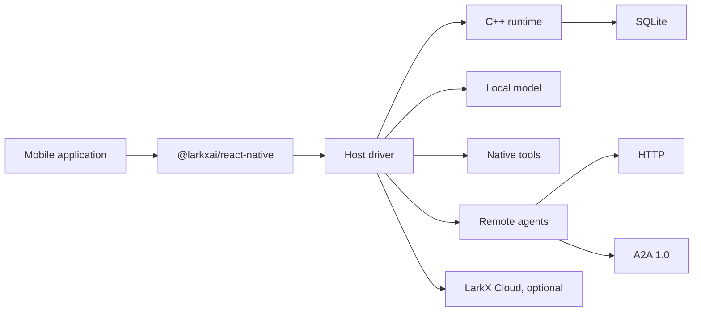

The C++ runtime owns orchestration, the SQLite record, replay, retries, operation ids, ownership, cancellation, unknown outcomes, reconciliation, and remote delegation state. The host driver performs the call the runtime asked for.

Local inference, native tools, and remote frameworks stay outside the core. Cloud does not own the local execution record.

## Public surface

React Native is the public SDK. The private workspace packages (`@larkxai/host`, `@larkxai/protocol`, `@larkxai/telemetry`, `@larkxai/cactus`, `@larkxai/node`) are how the repository is built. An application imports `@larkxai/react-native` only.

Swift and Kotlin SDKs are planned. `examples/swift-agent` is not that SDK.

## Engineering notes

Design notes stay in the git repository and are not part of this site's navigation. Read them on GitHub when you are changing the runtime:

- [Execution model](https://github.com/larkxai/larkx/blob/main/docs/architecture/execution-model.md)
- [Side effects](https://github.com/larkxai/larkx/blob/main/docs/architecture/side-effects.md)
- [Replay](https://github.com/larkxai/larkx/blob/main/docs/architecture/replay.md)
- [Remote delegation](https://github.com/larkxai/larkx/blob/main/docs/architecture/remote-delegation.md)
- [A2A](https://github.com/larkxai/larkx/blob/main/docs/architecture/a2a.md)
- [Telemetry](https://github.com/larkxai/larkx/blob/main/docs/architecture/telemetry.md)
- [Storage](https://github.com/larkxai/larkx/blob/main/docs/architecture/storage.md)
- [Mobile lifecycle](https://github.com/larkxai/larkx/blob/main/docs/architecture/mobile-lifecycle.md)

Device checklists live under `docs/validation/` in the same repository. A completed checklist is a phone run. This site does not mark that work done.
