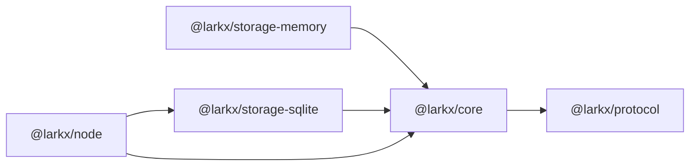

# RFC 0001 — Architecture

Status: accepted for the 0.1.0 local runtime. Sections marked "later" are design constraints, not shipped behavior.

## Problem

On-device agents need a recovery boundary that works without a remote orchestrator. The device may be suspended or killed between a side effect and the record of that side effect. A workflow engine that only runs while a process stays up does not solve that.

## Decision

LarkX is a TypeScript monorepo. The platform-independent core depends on a storage interface and on `@larkx/protocol`. Node and, later, React Native are adapters. Model providers are adapters above the engine, not dependencies of it.

Three product layers:

| Layer         | Where it lives                                                      | 0.1.0                          |
| ------------- | ------------------------------------------------------------------- | ------------------------------ |
| LarkX Runtime | This repository: protocol, core, storage, Node adapter              | Local execution is implemented |
| LarkX Agents  | Planned `@larkx/agent` on top of the same engine                    | Not implemented                |
| LarkX Cloud   | Private `larkxai/cloud`, plus a future public reference coordinator | Not implemented                |

## Package boundaries

`@larkx/protocol` has zero dependencies. It owns identifiers, the protocol version, state machines, effect and data-policy enums, event names, error codes, JSON values, and the remote dispatch request type.

`@larkx/core` owns workflow definitions, the execution loop, replay, the reducer, and the storage interface. It does not open files or sockets.

`@larkx/storage-sqlite` owns SQL, migrations, and transactional persistence. It receives a `SqliteDriver`. `@larkx/node` is the only package in this release that imports Node.

## Three version axes

| Axis                | Current value                       | Rule                                                                                         |
| ------------------- | ----------------------------------- | -------------------------------------------------------------------------------------------- |
| Protocol            | 1                                   | A stored run executes only on an equal protocol version. Mismatch blocks the run             |
| Storage schema      | 1                                   | Migrations live with the SQLite adapter. The core does not issue SQL                         |
| Workflow definition | Caller-supplied integer, at least 1 | The version used at `start` is stored. A later binary that lacks that version blocks the run |

These numbers move independently.

## Execution ownership

One owner per run. A claim stores `ownerId`, `ownershipEpoch`, and `leaseExpiresAt`. Commits include the epoch. A mismatched fence fails with `execution_ownership_conflict` and does not write.

The same owner renewing an active lease keeps the epoch. A claim that steals an expired lease, or that is explicitly allowed to steal, increments the epoch. Release also increments the epoch so a late commit from the previous holder fails.

The default lease is 30 seconds, renewed at one third of that interval. `leaseMs: 0` means the lease does not expire. Local execution does not take a remote lease.

On Node, a pid file next to the database records the owner. A new process may steal immediately when that pid is dead (`ESRCH`). A live pid is left alone. Lease expiry remains the fallback.

Two disconnected devices must not both own one mutable history. Cross-device ownership is a later coordination problem.

## Data policy

`device-only` is the default. The stored policy is the stricter of the engine policy and the workflow policy. Under `device-only`, a cloud or hybrid step fails with `permission_denied` before a handler runs. Under `cloud-allowed`, the same step fails with `unsupported_capability` because this runtime's capability set is local only.

## Authoritative state

For 0.1.0 the run row and the step rows are authoritative. The event table is an append-only journal written in the same transaction for history and debugging. Replay reads step records, not a fold of events. This is not full event sourcing.

Outbox and artifact tables exist so the schema can grow without a silent rewrite. The engine does not insert dispatch messages, and it does not copy artifact bytes.

## Later: agents

An agent loop must be a workflow. Each model call and each tool call is its own step, with stable keys such as `reason-0` and `tool-0-0`. Completed model outputs are replayed. The agent package must not keep a second write-ahead log. Private chain-of-thought is not a stored field. Messages, structured tool calls, tool results, and the final response are.

## Later: hybrid dispatch

The protocol type `RemoteDispatchRequest` is the request a future transport will send. The operation id is stable across retries of one logical operation. The engine will persist the outbox row and the waiting step in one transaction before any network call. A local fallback must not run while a remote side effect might still complete.

The public reference coordinator, when it exists, must persist accepted tasks and results. An in-memory HTTP server is not sufficient evidence of crash-safe remote orchestration.

## Later: Rust

Selected state and storage code may move to Rust. The TypeScript workflow function still needs a JavaScript runtime. The protocol, transition tables, and conformance tests are the migration boundary. See [rust-migration.md](../docs/architecture/rust-migration.md).

## Rejected for this milestone

- A Rust core now.
- Parallel steps before sequential replay is the tested default.
- Deriving step identity from source line numbers.
- Automatically shipping arbitrary closures to a remote worker.
- Putting billing, fleet control, or production authentication in this repository.
